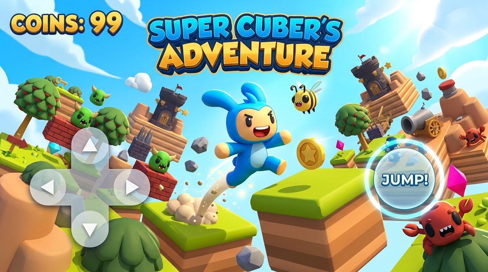
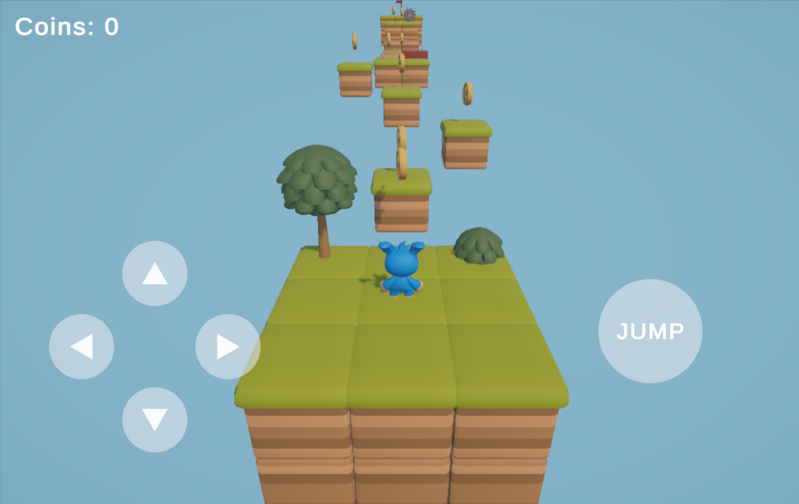
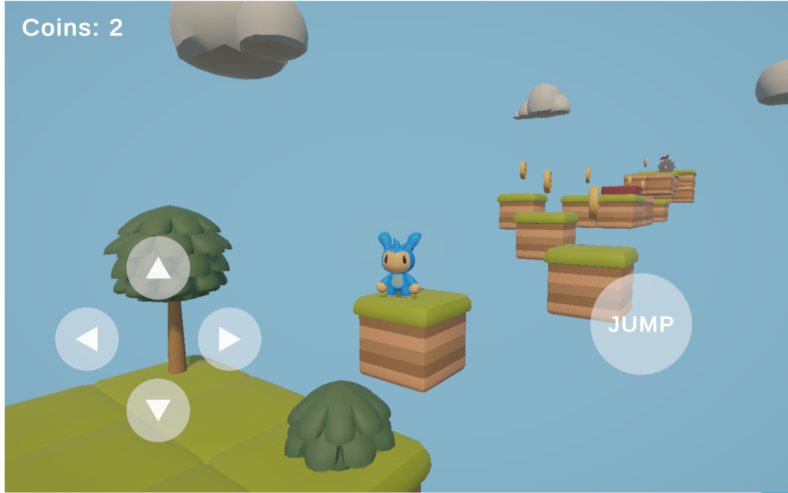
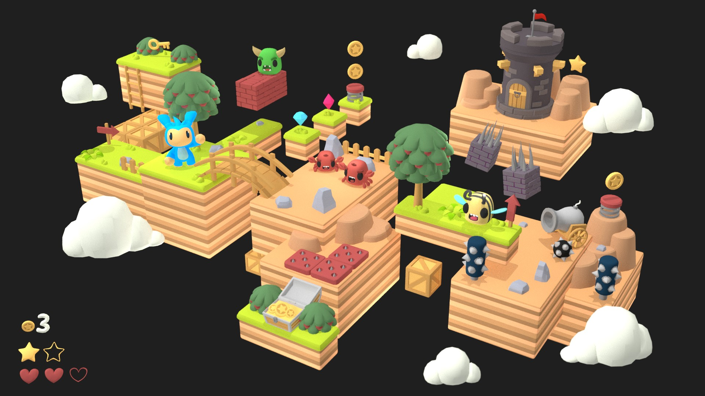
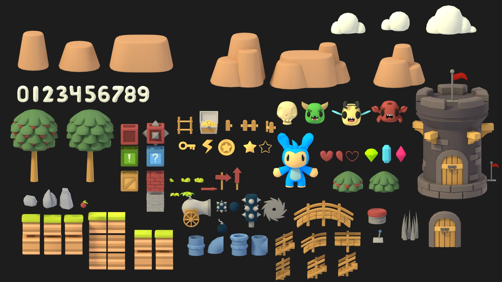

# 🎮 3D Web Platformer Game

[](https://platformgamebyusama.netlify.app/)
[](https://unity.com/)

A 3D web-based platformer game built in Unity and deployed to WebGL. Navigate floating island courses, collect coins, avoid deadly hazards, and reach the finish flag!

---

## 🌟 Live Demo

Play the live game directly in your browser:  
👉 **[https://platformgamebyusama.netlify.app/](https://platformgamebyusama.netlify.app/)**

---
| 
## 📸 Game Screenshots

### Gameplay & In-Game Action
| Perspective View | Top-Down View |
| :---: | :---: |
|  |  |

### World & Asset Kit
| Isometric Environment | Asset Showcase |
| :---: | :---: |
|  |  |

---

## ✨ Features

- 🎯 **Responsive On-Screen Controls:** Built-in touch/mouse controls (Movement D-Pad + Jump Button) optimized for web and mobile browsers.
- 🪙 **Collectibles & Scoring System:** Collect coins scattered across the course to boost your score.
- 🚧 **Challenging Obstacles:** Navigate around saw blades, floating platforms, spikes, and traps.
- 🎨 **Low-Poly Art Style:** Vibrant 3D platforming assets with clean visuals and smooth performance.
- 🌐 **WebGL Deployment:** Fast loading directly in modern desktop and mobile browsers via Netlify.

---

## 🎮 How to Play / Controls

### On-Screen Controls (Web/Mobile)
* **Arrow Buttons:** Move Forward, Backward, Left, Right
* **JUMP Button:** Jump over gaps and obstacles

### Keyboard Controls
* **W / A / S / D** or **Arrow Keys:** Move character
* **Spacebar:** Jump

---

## 🛠️ Built With

* **Game Engine:** [Unity Engine](https://unity.com/) (WebGL Build Support)
* **Assets:** Low-poly 3D Platformer Asset Pack (Kenney / Modular Platformer Kit)
* **Hosting Platform:** [Netlify](https://www.netlify.com/)

---

## 🚀 How to Run Locally

If you'd like to open and edit this project in Unity:

1. **Clone the repository:**
   ```bash
   git clone https://github.com/YOUR_USERNAME/YOUR_REPO_NAME.git
   ```
2. **Open in Unity:**
   - Open **Unity Hub**.
   - Click **Add** and select the cloned project folder.
   - Recommended Unity Version: `2021.3 LTS` or higher.
3. **Run the Game:**
   - Open `Assets/Scenes/MainScene.unity`.
   - Press the ▶️ **Play** button in the Unity Editor.

---

## 📁 Suggested File Structure for GitHub

To make sure your screenshots render correctly on GitHub, add your images into a `screenshots/` folder in your repository:

```text
├── Build/               # Unity WebGL build files
├── TemplateData/        # WebGL template assets
├── index.html           # Main WebGL launcher page
├── screenshots/         # Place your images here
│   ├── Preview.jpg
│   ├── Preview2.jpg
│   ├── Unity-Web-Player-Testing-10-31-2026_06_14_PM.jpg
│   └── Unity-Web-Player-Testing-10-31-2026_06_14_PM (1).jpg
└── README.md
```

---

## 🤝 Acknowledgments

- Special thanks to open-source 3D asset creators for the modular low-poly platformer kit.

---

*Made with ❤️ by Usama*
